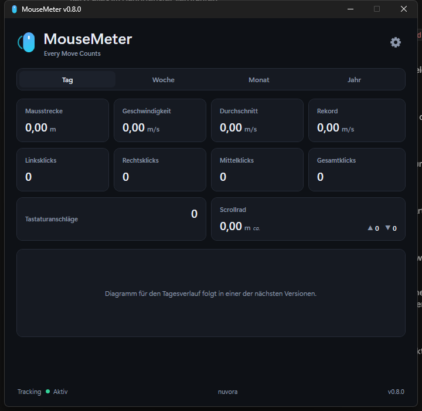

# MouseMeter

**Every Move Counts**

Portable Windows-Anwendung, die die tägliche Computeraktivität erfasst und
auswertet: zurückgelegte Mausstrecke, Mausgeschwindigkeit, Klicks und
Tastaturanschläge – automatisch im Hintergrund, ohne dass eine Messung manuell
gestartet werden muss.



## Aktueller Stand: v0.8.0

Alle zehn Dashboard-Kacheln zeigen echte, live erfasste Werte, und die
heutige Statistik wird jetzt dauerhaft gespeichert: Ein Neustart von
MouseMeter setzt Mausstrecke, Klicks, Tastaturanschläge und Scrollrad nicht
mehr zurück, sondern läuft nahtlos weiter. Der persönliche
Geschwindigkeitsrekord gilt jetzt für immer. MouseMeter erkennt außerdem
automatisch einen neuen Kalendertag und beginnt dann von selbst eine neue
Tagesstatistik. Beim Minimieren verschwindet MouseMeter aus der Taskleiste
und legt sich in die Ablage neben der Uhr. Was in dieser Version enthalten
ist, steht im [Changelog](CHANGELOG.md). Die Auswertung nach Woche, Monat
und Jahr folgt mit der nächsten Version.

Die Daten liegen als JSON-Datei in `data/` neben der EXE (portabel) - siehe
`tools/`-Abschnitt weiter unten für Details zum Speicherort.

## Aufbau

```
MouseMeter/
├─ src/
│  ├─ MouseMeter.sln
│  └─ MouseMeter/
│     ├─ App.xaml(.cs)              Programmstart, Einzelinstanz, Splash → Hauptfenster
│     ├─ Assets/                    Vektorlogo und Anwendungssymbol
│     ├─ Styles/Theme.xaml          Farben, Typografie, wiederverwendbare Bausteine
│     ├─ Views/                     SplashWindow, MainWindow, Settings-/ContactWindow
│     └─ Infrastructure/
│        ├─ Storage/                DailyStats, AppState, DataStore (Persistenz)
│        └─ *Tracker.cs, *Hook.cs   Maus-/Tastatur-/Scroll-Erfassung, Ablage-Symbol
├─ docs/                            Screenshots
├─ tools/                           Hilfsskripte
└─ releases/                        Versionsarchive (nicht im Git)
```

## Entwickeln

Voraussetzung: .NET SDK 10.

```bash
dotnet build src/MouseMeter.sln -c Debug
```

Starten:

```bash
dotnet run --project src/MouseMeter/MouseMeter.csproj
```

## Portable EXE erzeugen

Erzeugt eine einzelne, eigenständige `MouseMeter.exe` – ohne Installation, ohne
Adminrechte und ohne vorinstalliertes .NET lauffähig, also auch vom USB-Stick:

```bash
dotnet publish src/MouseMeter/MouseMeter.csproj -p:PublishProfile=Portable
```

Ergebnis: `publish/win-x64/MouseMeter.exe`

## Hilfsskripte

| Skript | Zweck |
| --- | --- |
| `tools/make-icon.ps1` | Erzeugt `Assets/MouseMeter.ico` neu (16–256 px) |
| `tools/make-release.ps1` | Legt `releases/MouseMeter_v<Version>.zip` als vollständigen Projektstand an |

## Versionierung

Jede abgeschlossene Version bleibt als vollständiger Projektstand erhalten:
als ZIP unter `releases/` und als Git-Tag. Bestehende Stände werden nie
überschrieben – `tools/make-release.ps1` bricht ab, wenn das Archiv schon
existiert.

## Datenschutz

MouseMeter arbeitet ausschließlich lokal. Es werden keine Daten an externe
Server übertragen. Bei der Tastatur wird ausschließlich die **Anzahl** der
Anschläge gezählt – niemals der eingegebene Text.
